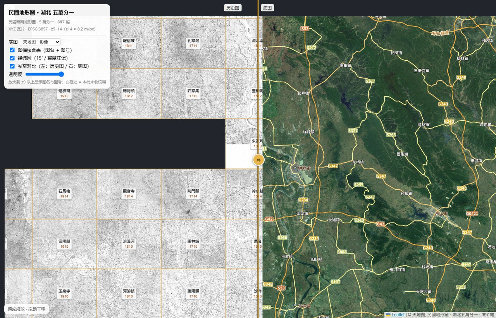

# 民國地形圖 · 湖北五萬分一（397 幅）

民國時期測繪的 1:50,000 地形圖，湖北及周邊 **397 幅**，已批量裁切、配準到 WGS84、逐幅去灰，
切成 XYZ 瓦片掛在 GitHub Pages 上，瀏覽器打開即用。

**在線瀏覽 → <https://ewlaker.github.io/hubei5w/>**



---

## 一、頁面功能

| 功能 | 說明 |
|---|---|
| 底圖切換 | 無（深色）/ 天地圖·矢量 / 天地圖·影像 / 天地圖·地形 / OpenStreetMap |
| 圖幅接合表 | 397 格，每格常顯「圖名 + 圖號」，點格看行列號 |
| 經緯網 | 15′ 間隔，整度線加粗並注記 `108°E / 31°N` |
| **卷簾對比** | 左歷史圖、右底圖，拖中間圓柄；接合表與注記只在左側 |
| 透明度 | 疊在底圖上看時可調 |
| URL 定位 | `?z=11&lat=31.2&lon=112.3`；卷簾直達 `?swipe=1&pos=52&base=tdt_img` |

天地圖需要 key，頁面裡 `TDT_KEY` 目前借用第三方（有配額限制），建議到
<https://console.tianditu.gov.cn> 免費申請一個換掉。

---

## 二、在 GIS 裡用

### QGIS

瀏覽器面板 → **XYZ Tiles** → New Connection，URL：

```
https://ewlaker.github.io/hubei5w/xyz_hubei_webp/{z}/{x}/{y}.webp
```

**Min zoom = 5，Max zoom = 14**（填錯會一片空白）。也可直接打開倉庫裡的
`湖北五万_在线瓦片.qgz`（瓦片 + 接合表 + 經緯網三層，已配好）。

### ArcGIS

Esri 的 Web 瓦片圖層**不支持 WebP**。兩條路：

1. **COG + `/vsicurl/`**（推薦）：Add Data → Add Data From Path，填
   `/vsicurl/https://<靜態空間>/hubei5w_cog.tif`。
   COG 未上傳（3.8 GB，超過 GitHub 單倉建議容量），本機在 `hubei5w_cog.tif`，
   要上線就傳 Cloudflare R2 / 阿里雲 OSS（需支持 HTTP Range）。
2. **另出一套 PNG 瓦片**：體積約 10 倍，要單獨找地方放。

---

## 三、數據規格

| 項 | 值 |
|---|---|
| 幅數 | 397（1:50,000，每幅 15′×10′） |
| 覆蓋範圍 | 東經 108.562–116.312°，北緯 29.000–33.333° |
| 坐標系 | WGS84（名義分幅），瓦片為 EPSG:3857 |
| 瓦片 | z5–14，256 px，WebP q85，空白透明 |
| 瓦片數量 | **54,801** 塊（已剔除 54,508 塊全透明：請求返回 404，客戶端按空白處理） |
| 瓦片體積 | **1,190 MB** |
| 最高精度 | z14 ≈ 8.2 m/px（原掃描件 ≈ 5.3 m/px） |
| 影像處理 | 逐幅歸一去灰：紙色 → 254、暗部 p2 → 45，增益上限 3.0 |
| 原始數據 | `05_crop` 無損 PNG（4500×3500，灰度），`08_geo` GeoTIFF（DEFLATE + 金字塔） |

**為甚麼最高只到 z14**：全省 z15 約 16 萬塊，超過 GitHub 單倉 10 萬文件上限。
要原生精度請走 COG 路線（單文件、內部金字塔、按視野取塊）。

---

## 四、倉庫結構

```
.
├── index.html                 單頁地圖（Leaflet，無構建）
├── preview.jpg                頁面截圖
├── 接图表_A3.pdf               接圖表（A3，圖號）
├── 接图表_预览.jpg             接圖表預覽
├── 图幅清单.csv                397 幅清單：圖號/圖名/行列/經緯範圍
├── sheets_index.geojson       397 格接合表（圖名 + 圖號 + 行列）
├── graticule.geojson          15′ 經緯網（37 經線 + 20 緯線 + 110 個整度注記點）
├── 湖北五万_在线瓦片.qgz        QGIS 工程
├── xyz_hubei_webp/            z5–14 WebP 瓦片
├── 发布说明.md                 產物清單、復現命令、踩坑
└── 上线记录.md                 上線驗收、歷次修訂
```

**接圖表**：[接图表_A3.pdf](接图表_A3.pdf)（A3，標圖號；A2 帶圖名的版本見本地 `10_接图表/`）。
佈局含：名義網格 806 格（已收 397 格、未收 409 格）、湖北省界、30′ 經緯網、行列號、比例尺。

> 倉庫有 5 萬多個文件、1.2 GB，**clone 會很久**。只是要用底圖的話直接接瓦片 URL 即可。

---

## 五、坐標精度（重要）

- 圖幅範圍是**名義分幅**（依民國圖幅編號規則推的理論經緯），不是實測控制點，
  與 CGCS2000/WGS84 之間存在系統差；**適合疊加瀏覽、檢索、排布，不作量測依據**。
- 2026-09 曾把全部 GeoTIFF 的 geotransform **整體東移 6000 m**（≈0.063°），
  以便與現代底圖對位。接合表已按**移位後**的實際 geotransform 重建，兩者嚴絲合縫。
- 但 `08_geo/sheet_manifest.csv` 與 `hubei_existing_sheets.shp` 仍是**移位前**的舊範圍，
  拿它們做分析時經度需 +0.0627°；新代碼請直接讀 `georef_table.json`。

---

## 六、製作流程

```
原始掃描(CCRR-圖名.jpg)
 ① 糾斜（投影方差法）
 ② 認外框（粗黑線，投影峰 + 寬高比/覆蓋度校驗）
 ③ 裁到外框 + 內縮 2.5% 去掉圖廓線帶
 ④ 內容邊界識別（密度投影，寧留邊距不切內容）
 ⑤ 裁到內圖廓 → 4500×3500 無損 PNG
 ⑥ 提名義經緯範圍 → GeoTIFF(WGS84, DEFLATE, 金字塔)
 ⑦ 逐幅歸一去灰（紙色→254、暗部→45）
 ⑧ VRT 合成 → 3 波段外殼 → gdal2tiles 切 WebP → Pages 上線
```

座標規則：`west = 116.25 − 0.25×列`、`south = 33.3333 − 行/6`（每幅 15′×10′，列號自東向西、行號自北向南）。

復現命令與逐條踩坑見 **[发布说明.md](发布说明.md)**，上線驗收與歷次修訂見 **[上线记录.md](上线记录.md)**。

---

## 七、更新

```bash
git clone https://github.com/EWlaker/hubei5w.git
cd hubei5w
# 改完 index.html / geojson / 瓦片
git add -A && git commit -m "更新" && git push
```

大瓦片倉庫每次提交都會漲歷史體積，建議少提交或用 `git commit --amend`。

---

## 八、聲明

- 底圖數據為民國時期公開出版的地形圖掃描件，掃描源與原始分幅圖由公開檔案館/圖書館數字化。
- 本倉庫提供的是**處理後的衍生數據**（裁切、配準、去灰、切片），僅供研究、教學與個人瀏覽。
- 名義分幅坐標不可作為行政、工程或法律依據。
